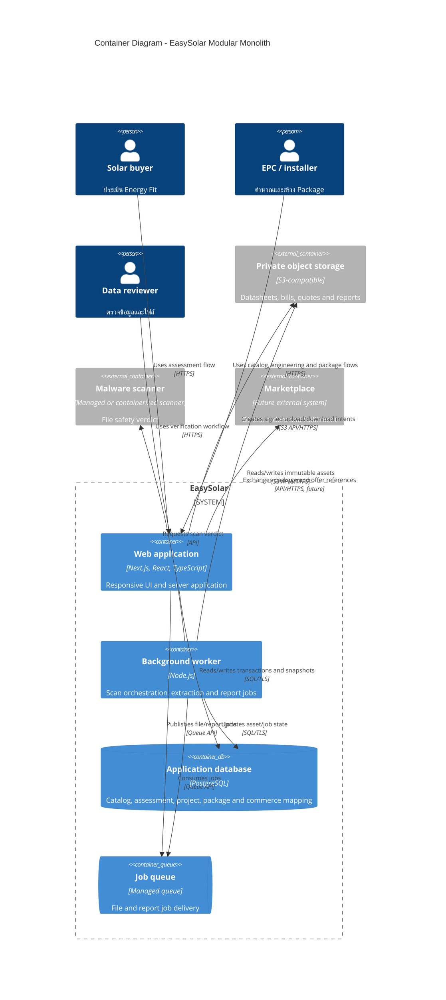

# EasySolar Container Architecture

## Deployment direction

Keep the web/API and domain engines in one deployable application initially. Add a worker and queue only when file scanning/OCR/report jobs begin. PostgreSQL and object storage are required before real Datasheets are published. Marketplace remains an integration boundary until transaction scope is approved.
