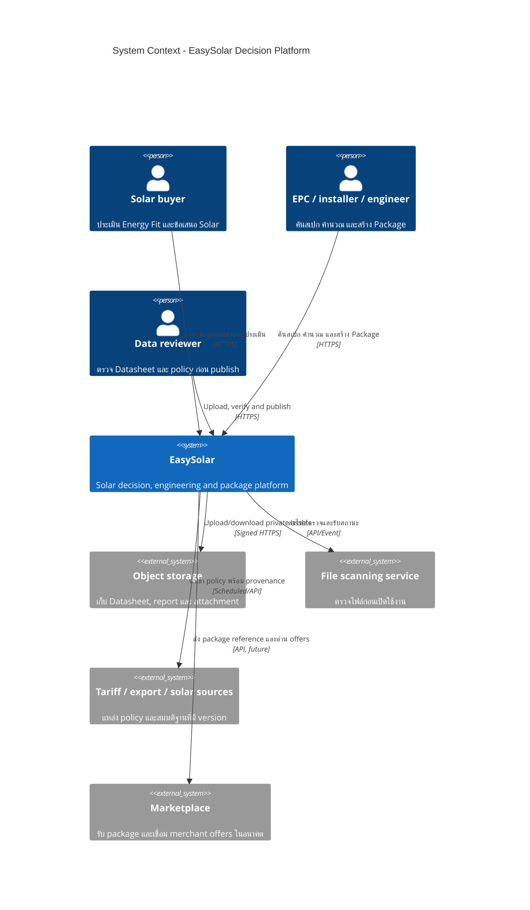

# EasySolar System Context

## Boundary

EasySolar owns canonical equipment, versioned policies, deterministic calculations, projects and packages. Object bytes, scanning and future Marketplace transaction processing remain external boundaries. Marketplace price or stock cannot influence engineering safety findings.
