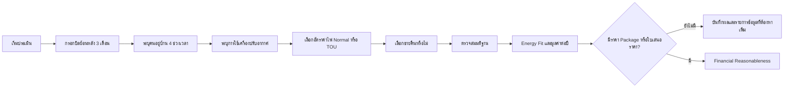
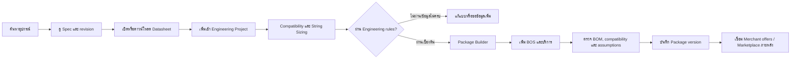

# EasySolar Journey–Feature Alignment

## Executive decision

EasySolar มีสอง Journey หลักที่ใช้ platform และข้อมูลกลางร่วมกัน แต่ต้องแยกคำถาม ผลลัพธ์ และระดับความรับผิดชอบให้ชัดเจน

1. **Solar Buyer Journey** — ผู้ใช้ไฟหรือผู้ที่กำลังพิจารณาติด Solar ต้องการรู้ว่าโหลดไฟเหมาะกับ Solar เพียงใด และข้อเสนอมีมูลค่าทางการเงินสมเหตุสมผลหรือไม่
2. **Professional Journey** — EPC, installer และ engineer ต้องการข้อมูลอุปกรณ์ที่เชื่อถือได้ การคำนวณทางวิศวกรรม และการจัดชุดอุปกรณ์ก่อนเชื่อมไปสู่ Marketplace

## Important decision boundary

เมื่อยังไม่มีราคาติดตั้ง ระบบ **ห้าม** สรุป ROI, payback หรือคำว่า “คุ้ม/ไม่คุ้ม” ในความหมายการลงทุน เพราะยังไม่มีต้นทุนให้เปรียบเทียบ ระบบตอบได้เพียง:

- **Energy Fit:** รูปแบบการใช้ไฟเหมาะกับ Solar ระดับใด
- ขนาดระบบเบื้องต้นและช่วงพลังงานที่ผลิตได้
- สัดส่วนใช้เองและส่งออก
- มูลค่าค่าไฟที่อาจประหยัด/ขายคืนต่อปี
- ความมั่นใจ สมมติฐาน และข้อมูลที่ยังขาด

เมื่อมีราคาจาก Package Builder หรือใบเสนอราคา จึงเปิดผล **Financial Reasonableness** เช่น payback, NPV/IRR, sensitivity และ price reasonableness

## Journey A — Solar buyer

### Goal

ช่วยเจ้าของบ้านหรือธุรกิจเข้าใจศักยภาพ Solar จากบิลและพฤติกรรมใช้ไฟ โดยไม่บังคับให้รู้ศัพท์วิศวกรรม

### Recommended flow

### Input contract

#### Step 1 — Electricity history

- ให้กรอกค่าไฟแต่ละเดือนย้อนหลัง 3 เดือน แทนการให้ผู้ใช้คำนวณค่าเฉลี่ยเอง
- เก็บ `billing_month`, `bill_amount_thb` และ `energy_kwh` เมื่อหาได้จากบิล
- ระบบคำนวณค่าเฉลี่ยและความแปรปรวนให้
- หากมีเพียงค่าเฉลี่ย 3 เดือน ให้ทำต่อได้แต่ลด confidence และแสดงว่าใช้ข้อมูลสรุป

#### Step 2 — Four daily occupancy periods

ช่วงเวลาเป็น policy ที่แก้ได้ ไม่ hard-code ใน calculation engine ข้อเสนอเริ่มต้น:

1. เช้า `06:00–10:00`
2. กลางวัน `10:00–16:00`
3. เย็น `16:00–22:00`
4. กลางคืน `22:00–06:00`

แต่ละช่วงเก็บจำนวนคนที่อยู่เป็นส่วนใหญ่ ค่า `0` ต้องรองรับและไม่เท่ากับ “ไม่ทราบ”

#### Step 3 — Air-conditioner usage

- ระบุช่วงเวลาที่เปิด
- MVP เก็บจำนวนเครื่องและชั่วโมงโดยประมาณต่อช่วง
- Advanced input ภายหลังเก็บ BTU, inverter/non-inverter, setpoint และอายุเครื่อง
- หากตอบเพียงเปิด/ไม่เปิด ระบบใช้ proxy ที่มี version และแสดง confidence ต่ำกว่า

#### Step 4 — Tariff

- เลือก `Normal` หรือ `TOU`
- ต้องเลือกประเภทมิเตอร์/ผู้ใช้ไฟที่ตรงกับ tariff version
- Tariff rate, Ft, on-peak/off-peak calendar และ effective date มาจาก versioned policy ไม่ฝังใน UI
- หากผู้ใช้ไม่ทราบ ให้ช่วยค้นจากบิลหรือเลือก “ไม่ทราบ” และลด confidence

#### Step 5 — Export

- เลือก `ไม่ขายคืน`, `ต้องการขายคืนแต่ยังไม่มีสัญญา`, หรือ `มีสัญญา/โครงการรับซื้อ`
- ถ้าไม่มีสัญญา รายได้ส่งออกเป็น `0` แต่ยังแสดงพลังงานส่วนเกิน
- ถ้ามีสัญญา ต้องเลือก export policy/version หรือระบุอัตราพร้อม source

### Results

- Load profile proxy แยก 4 ช่วงเวลา
- Suggested PV size range และเหตุผล
- Annual generation range
- Self-consumption, grid import และ export range
- Annual avoided electricity cost และ export revenue แยกกัน
- Energy Fit level: `LOW`, `MODERATE`, `HIGH` พร้อมเหตุผล ไม่ใช้สีอย่างเดียว
- Confidence/coverage, assumptions, missing inputs และ sensitivity
- Financial metrics แสดงเฉพาะเมื่อมี installed/package cost

### Required states

Draft, incomplete bill data, unknown tariff, proxy load profile, export policy unavailable, calculation error, result ready, result expired by policy version และ saved snapshot

## Journey B — EPC / installer / engineer

### Goal

ค้นข้อมูลอุปกรณ์ที่มีหลักฐาน ตรวจทางวิศวกรรม และประกอบ Package ที่ตรวจสอบได้ก่อนเชื่อมไปยังการขาย

### Recommended flow

### Professional capabilities

- Equipment search by manufacturer, exact model, category, market และ verification state
- Datasheet preview/download พร้อม revision, language, checksum และ source
- Engineering calculation with immutable equipment snapshot
- Project and design alternatives
- Package Builder แบบ customized BOM
- Package items: module, inverter, mounting, cable, connector, combiner, protection, monitoring, service และ custom line
- Engineering validation แยกจาก stock, price, seller และ sponsorship
- Package version, calculation snapshot, warnings และ report
- Marketplace link แสดงเฉพาะ offer ที่ map กลับ canonical product/variant ได้

## Match with current product

| Journey step | Current route/capability | Match | Required change |
| --- | --- | --- | --- |
| เลือกกลุ่มผู้ใช้ | `/` dual-audience entry | Aligned | เพิ่ม account-aware entry ภายหลัง |
| Solar buyer เข้าใจขอบเขต | `/solar-value` | Aligned foundation | เปลี่ยนเป็น 5-step wizard เมื่อ engine พร้อม |
| กรอกบิล/พฤติกรรมใช้ไฟ | `/solar-value/new` five-step local draft | Input flow implemented | ต่อ Supabase persistence, consent และ anonymous retention policy |
| Energy Fit result | ไม่มี | Gap | สร้าง load proxy, tariff/yield policy และ engine |
| Financial reasonableness | มีเพียง product definition | Deferred | เปิดเมื่อมี package/quote cost |
| ค้นอุปกรณ์ | `/equipment` demo catalog | Partial | ต่อ PostgreSQL, filter, pagination, real records |
| ดู/โหลด Datasheet | UI ยังไม่มี file delivery | Gap | Object storage, signed download และ asset metadata |
| Engineering calculation | `/checker` | Prototype match | ต่อ verified catalog/project persistence |
| Data verification | `/admin/equipment` | Scaffold match | Upload, scan, extraction, review, publish workflow |
| Package Builder | ไม่มี | Gap | เพิ่ม project/package/version/BOM UX |
| Marketplace | ไม่มี | Intentionally deferred | แยก commerce offer จาก engineering catalog |

## Target information architecture

### Public

- `/` — audience entry
- `/solar-value` — assessment landing or active draft
- `/solar-value/new` — responsive five-step Energy Fit input wizard; local draft and validation implemented, calculation pending policy integration
- `/solar-value/[assessmentId]/result` — result, assumptions and confidence
- `/equipment` — verified catalog
- `/equipment/[modelId]` — model, revisions, specs and datasheet assets

### Professional, sign-in required when persistence opens

- `/projects` — project list
- `/projects/[projectId]` — project overview and design alternatives
- `/projects/[projectId]/engineering` — compatibility and sizing workspace
- `/projects/[projectId]/packages` — package versions
- `/projects/[projectId]/packages/[packageId]` — Package Builder and BOM validation

### Operations

- `/admin/equipment` — review queue
- `/admin/equipment/[revisionId]` — upload, extraction, field verification and publish
- `/admin/policies` — tariff, export, yield and calculation policies
- `/admin/commerce` — merchant offer mapping when Marketplace work begins

## UX rules

- Consumer flow uses one decision per step, autosave, progress, back/continue และ review-before-calculate
- Professional workspace may be denser but must retain units, revision and rule trace next to values
- Responsive validation is required at 390px, 768px and 1440px for every new screen
- Mobile Package Builder becomes a linear item list with sticky summary/action; desktop may use catalog + BOM split view
- Upload progress, scan pending, quarantined, extraction failed, no permission และ expired download are first-class states
- Datasheet download must show file name, revision, language, size and verification status before action

## Stable requirements

- **FR-JRN-001:** A user can enter three monthly bills or one three-month average; the system records which input quality was used.
- **FR-JRN-002:** A user can record occupancy count and AC usage for each of four policy-defined time periods.
- **FR-JRN-003:** A user can select tariff and export intent without being forced to guess unknown policy details.
- **FR-JRN-004:** The Energy Fit result separates avoided bill, export revenue, assumptions and missing data.
- **FR-JRN-005:** Financial metrics remain unavailable until a cost input exists.
- **FR-JRN-006:** A professional can preview/download the exact datasheet revision used by a calculation.
- **FR-JRN-007:** A professional can create a versioned package from canonical equipment and custom BOS/service lines.
- **FR-JRN-008:** Package engineering validation is independent from price, inventory and merchant ranking.
- **FR-JRN-009:** A merchant offer must map to a canonical sellable item before Marketplace publication.
- **NFR-JRN-001:** Every calculation stores input, policy, equipment and engine version snapshots.
- **NFR-JRN-002:** Private files use short-lived signed URLs and are never exposed through predictable public keys.
- **NFR-JRN-003:** All new UI passes the project responsive matrix and keyboard navigation checks.

## Recommended next vertical slice

Build **Datasheet Storage + Persistent Catalog** first:

1. Admin creates product/revision and uploads a PDF
2. File is validated, hashed, scanned and stored privately
3. Reviewer verifies fields and publishes the revision
4. Public catalog displays the verified revision
5. User previews/downloads with an auditable signed URL

This slice replaces demo data, establishes database/file governance, and becomes the shared foundation for engineering, Package Builder and Marketplace mapping.
